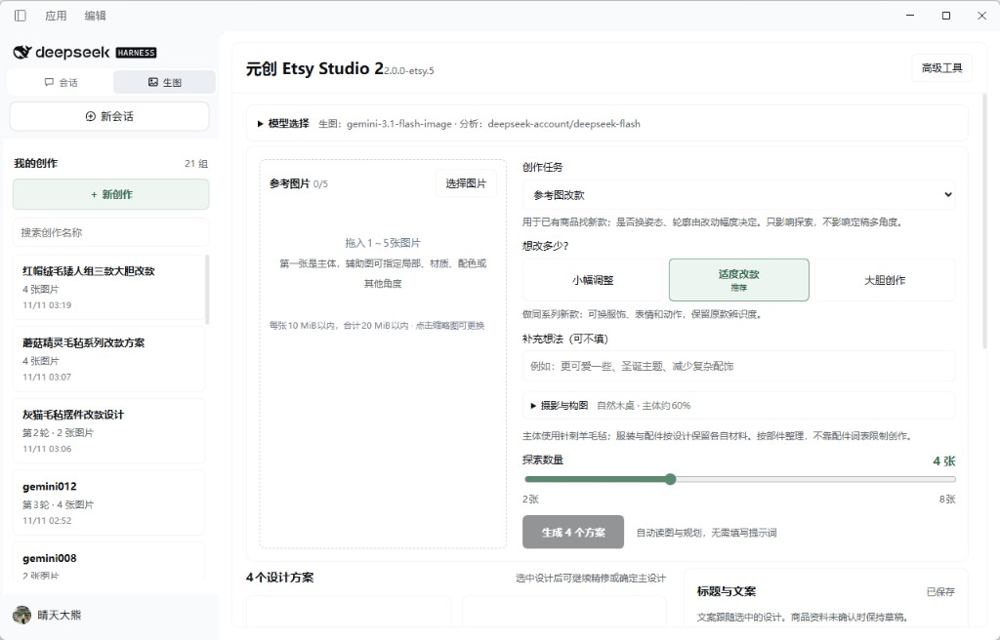

# 元创 Etsy Studio 2

当前版本 **2.0.0-etsy.6**。它是 DeepSeek Harness 的生图插件。打开原来的 DSH 桌面程序，点击「生图」进入。

## 安装和更新

每个版本的双击安装文件在 [Releases](https://github.com/CUMT-qtdx/yuanchuang-etsy-plugin/releases)。

下载 `Update-Yuanchuang-Etsy-*.exe`，双击一次即可安装或更新。不用解压，不用删除旧版。已有商品、图片和渠道配置会保留。窗口提示安装成功后，重新打开 DeepSeek Harness。标题旁的版本号应与所安装的版本一致。

页面上的 Source code 压缩包是 GitHub 自动附带的源码，不是安装程序。

## 2.0.0-etsy.6 改了什么

相对 2.0.0-etsy.5，这一版只改界面。生图规则、材质流程和已有功能都没有删。

- 标题改为「元创 Etsy Studio」，版本号单独放在标题下面。
- 工作台改成中间看图、右边操作。参考图、创作任务、改动幅度、摄影、生成、方案、修改、多角度、文案和商品资料都还在。
- 摄影与构图固定展开，不再带折叠箭头。
- 右边栏加宽。栏内自己滚动，生成按钮固定在栏底。
- 主按钮、选中状态和版本号改回上一版绿色。

## 材质流程

同一次规划分别生成造型简报和部件材料，再接一段针毡规则、已有摄影与构图，然后交给图像模型。新版路径不按配件名词扫描、替换或拒绝自然语言，不再叠加 17 图长模板。

本仓库是插件源码。账号、商品图片和本机数据目录不在这里。

原项目许可与致谢见 `LICENSE`、`THIRD_PARTY_NOTICES.md`。
